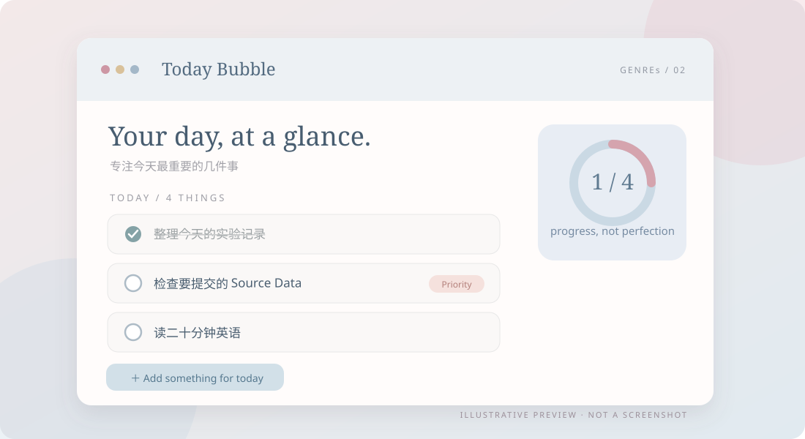

[README.md](https://github.com/user-attachments/files/34538382/README.md)
# Desktop-TodoList
A gentle desktop to-do app for organizing daily tasks, setting priorities, and making room for what matters.
<p align="center">
  
</p>

<p align="center"><strong>Less noise. Just today.</strong><br /><sub>把今天要做的事，放进一个轻轻的气泡。</sub></p>

<p align="center"><code>GENREs / 02</code> · Electron · Windows · Desktop To-do</p>

**Today Bubble** is a lightweight desktop to-do app for focusing on what matters today. Capture tasks, choose your priorities, and make steady progress without the weight of a complex project-management system.

### ✦ What you can do

| Capture | Prioritize | Stay focused |
| :--- | :--- | :--- |
| Add, edit, complete, or remove tasks | Highlight important items and drag to reorder | Keep your list nearby with a compact floating view |

Customize **profiles and themes**, and export completed or organized tasks as **Markdown archives**.

### ✦ A closer look

<p align="center"></p>

<sub>Illustrative UI concept based on actual features. Tasks are examples; this is not an application screenshot.</sub>

### ✦ Get started

Install **Node.js ≥ 22.12** and npm. From the project directory, run:

```bash
npm ci
npm start
```

On Windows, you can also double-click `todo.cmd` after running `npm ci`. This is a **source-code release**, not a prebuilt installer.

### ✦ Data & privacy

- Tasks and preferences are stored **locally** in Electron's application data directory; no cloud account is required.
- Markdown archives are written to `Documents/TodayBubble/Archives` on your computer.
- Please back up important tasks and archive files yourself.

<details>
<summary><strong>🇨🇳 简体中文 · 中文介绍</strong></summary>

**Today Bubble** 是一款专注「今天」的轻量桌面待办工具。记录、排序、完成任务，把注意力留给最重要的事情。

- **任务管理**：新建、修改、完成、删除待办事项。
- **优先级**：标记重点、拖动排序，并通过紧凑悬浮视图随时查看。
- **个性化**：多用户档案、主题，以及 Markdown 归档。
- **运行**：安装 Node.js ≥ 22.12，依次执行上方的 `npm ci`、`npm start`；Windows 也可使用 `todo.cmd`。
- **隐私**：任务数据保存在本机，归档文件位于 `Documents/TodayBubble/Archives`。

上方图片为功能示意图，并非程序实际截图。

</details>

<p align="center"><sub>Made for unhurried days, by <strong>GENREs</strong> · Little tools, lovingly made.</sub></p>
